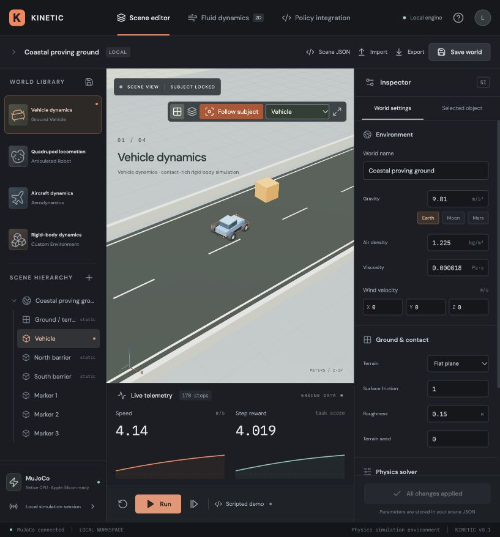
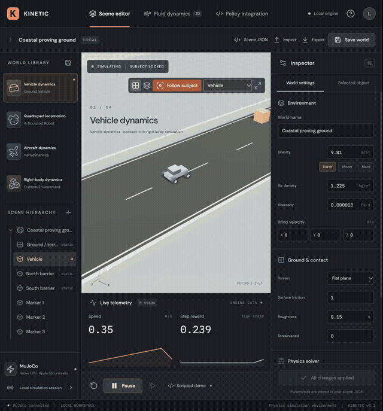
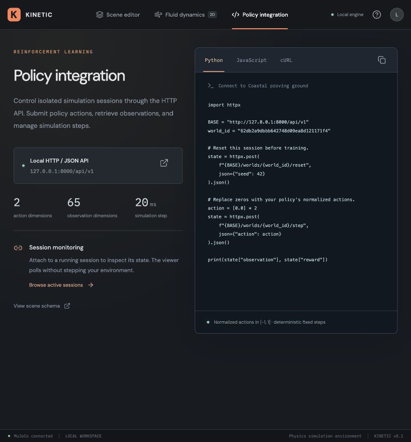
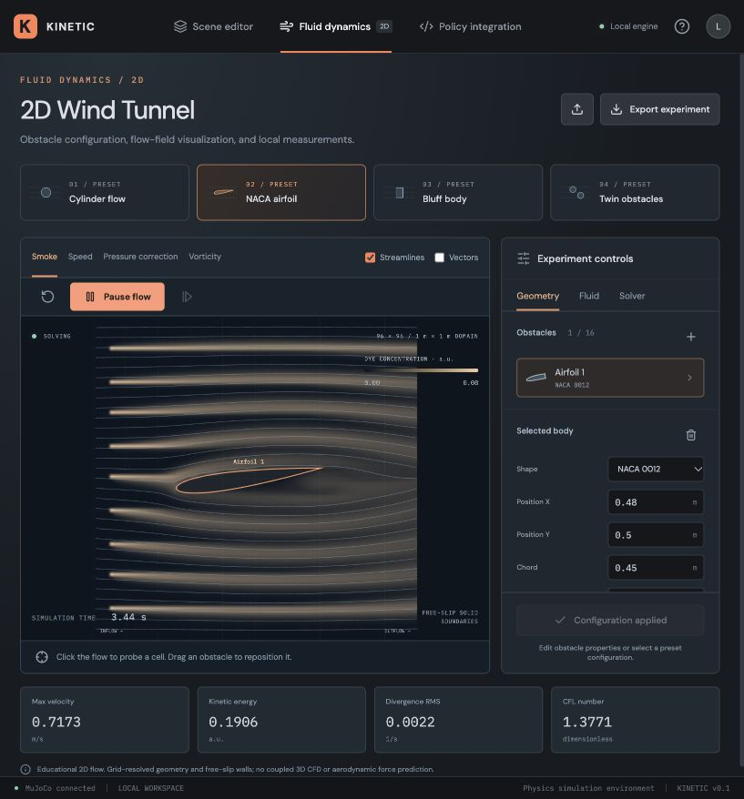

# Kinetic Simulation

**Physics simulation for reinforcement learning, robotics and interactive experiments.**

Kinetic brings MuJoCo dynamics, a browser studio, Gymnasium adapters and a language-neutral HTTP API into one local workspace. Build worlds for vehicles, legged robots and aircraft, connect your own policy, and see how it behaves. Start on an Apple Silicon Mac or Linux CPU; use the optional NVIDIA/MJX path for compatible batched models.



[Get started](#get-started) · [Train a policy](#train-and-watch-a-policy) · [Use with an agent](docs/agent-quickstart.md) · [Documentation](#documentation)

## See it in action

[](docs/media/kinetic-demo.mp4)

[Watch the full demonstration](docs/media/kinetic-demo.mp4) · [Vehicle subject tracking](docs/media/vehicle-tracking.mp4) · [2D wind tunnel](docs/media/wind-tunnel.mp4)

These recordings show the actual studio. The **Run** button uses a scripted controller; vehicle demonstration footage shows simulation and camera behavior, not a trained policy.

## What is included

| Workspace | Capabilities |
| --- | --- |
| **Scene editor** | MuJoCo rigid-body dynamics; vehicle, quadruped, aircraft and sandbox templates; terrain and primitive objects; editable physical parameters; JSON import/export. |
| **Subject tracking** | Follow a robot or named object while it moves. Orbit and zoom remain available, and tracking follows episode resets. |
| **Policy integration** | In-process Gymnasium training, HTTP sessions for any language, and a read-only viewer for externally controlled rollouts. |
| **Fluid dynamics** | Independent 2D incompressible flow; circular, rectangular, elliptical, NACA and polygon obstacles; smoke, speed, vorticity and pressure-correction fields; streamlines and probes. |
| **Agent workflow** | A project-local skill for creating worlds, configuring physics, integrating models and measuring evaluation runs. |

**v0.1 — research foundation.** The built-in tasks provide starting environments, not complete autonomous-driving or robotics stacks. Aerodynamics are approximate. The 2D fluid solver is educational and does not apply forces to the rigid-body simulation. See [physics and fidelity](docs/physics.md) before interpreting results.

## Get started

Use an Apple Silicon Mac or Linux machine with **Python 3.11+** and **Node.js 22+**. Python 3.12 is the verified baseline. Run these commands from a terminal:

```bash
git clone https://github.com/Rajneesh100/kinetic-rl-sim.git rl_sim
cd rl_sim
python3 -m venv .venv
.venv/bin/python -m pip install --cache-dir .cache/pip -e .
npm ci --prefix web --cache .cache/npm
npm run build --prefix web
.venv/bin/rl-sim serve
```

Open [the studio](http://127.0.0.1:8000) and [interactive API documentation](http://127.0.0.1:8000/docs). Keep the server running while using the studio or remote clients.

1. In **Scene editor**, choose an environment and press **Run** for a scripted preview.
2. Enable **Follow subject** in the viewport toolbar and select the robot or object to keep centered.
3. Pause to edit geometry and physical parameters. Export JSON to keep a reusable world configuration.

The camera follows the subject; physics coordinates stay unchanged. Panning is disabled during tracking. Turn tracking off to explore freely, or use **Reset camera** for the default view.

## Train and watch a policy

Install the optional training package, then run the included PPO example:

```bash
.venv/bin/python -m pip install --cache-dir .cache/pip -e '.[train]'
.venv/bin/python examples/train_ppo.py \
  --template driving --steps 50000 --envs 4 --seed 42 --device cpu
```

This trains a small policy against the example locomotion reward. It saves a checkpoint to `data/models/driving-ppo.zip` and records training metadata and CSV logs under `data/training/`. A completed training run does not establish policy quality; evaluate it on your task and seeds.

With the studio server running in another terminal, evaluate the checkpoint visually:

```bash
.venv/bin/python examples/rollout.py \
  --template driving --model data/models/driving-ppo.zip \
  --remote --realtime --steps 3000 --seed 43 \
  --output data/rollouts/driving-evaluation.jsonl
```

The command prints a world ID. In **Policy integration → Browse active sessions**, select that session, then enable **Follow subject**. The policy controls simulation time while the viewer observes it. Keep the rollout running; its session is deleted when it finishes.



For your own Python model, use the standard Gymnasium loop:

```python
from rl_sim.sdk import LocalEnv

env = LocalEnv(template="quadruped")
observation, info = env.reset(seed=42)
try:
    for _ in range(1000):
        action = env.action_space.sample()  # Replace with your policy(observation).
        observation, reward, terminated, truncated, info = env.step(action)
        if terminated or truncated:
            observation, info = env.reset()
finally:
    env.close()
```

`LocalEnv` is the direct CPU training path. Use `RemoteEnv` to drive a session visible in Studio. Read [model integration](docs/integration.md) for custom rewards, observations, episode handling and reproducibility.

## Connect from any language

The HTTP API uses JSON and explicit reset/step calls. Query each world's description for its action and observation dimensions; actions are normalized to `[-1, 1]`.

| Request | Purpose |
| --- | --- |
| `POST /api/v1/worlds` | Create a session from a template or scene JSON. |
| `POST /api/v1/worlds/{id}/reset` | Start an episode with an optional seed. |
| `POST /api/v1/worlds/{id}/step` | Submit an action and receive observation, reward and episode flags. |
| `GET /api/v1/worlds/{id}/state` | Observe the world without advancing it. |
| `DELETE /api/v1/worlds/{id}` | Release the session. |

Try the dependency-free [JavaScript client](examples/client.mjs) with `node examples/client.mjs`. Python, Rust, Go, C++, Julia and other languages can use the same [API contract](docs/contract.md).

## Build worlds with an agent

Open this repository in your coding agent and give it [skills/rl-sim/SKILL.md](skills/rl-sim/SKILL.md). Clients that discover project-local `.agents/skills` can use the included `rl-sim` skill directly. No additional hosted model key is required by the simulator.

Example request:

> Use the rl-sim skill to build a quadruped terrain course with ramps and low steps. Keep every file in this project. Expose a seed, friction and obstacle height; validate the scene and run a short seeded smoke test. Then connect my policy, show the evaluation in Studio with subject tracking, and save the scene and measured rollout results.

The [agent quickstart](docs/agent-quickstart.md) includes ready-to-use prompts for world creation, model integration, training and fluid experiments, plus a validation workflow. Agents create editable JSON worlds using the same public schema as the studio.

## Explore fluid dynamics



Open **Fluid dynamics** and choose a preset. Edit or drag obstacles, then **Apply & restart**. Switch fields, enable streamlines or velocity vectors, and click to probe a cell. Import [the airfoil example](examples/wind_tunnel.json) or configure the solver through HTTP.

Geometry, inlet speed, viscosity, dye sources, resolution, timestep and projection iterations are configurable. Pressure correction is a numerical diagnostic, not pressure in Pa or a lift/drag measurement. Read the [fluid guide](docs/fluid-lab.md) for units, export behavior and model assumptions.

## Hardware

| Platform | Execution path |
| --- | --- |
| **Apple Silicon Mac** | Native MuJoCo CPU physics, NumPy CPU fluids and browser WebGL rendering. Primary local development platform; no CUDA needed. |
| **Linux CPU** | The same local studio, API and Gymnasium path. |
| **Linux with NVIDIA GPU** | Optional MJX/JAX batched physics for compatible models. Separate from HTTP worlds; task rewards and policy batching remain the caller's responsibility. |

Mac Metal/MPS physics is not implemented. The MJX path has been checked with real CPU batches; NVIDIA execution and throughput have not been verified on the development Mac. Some built-in models require explicit compatibility changes before MJX can run them. Follow [hardware setup and compatibility](docs/hardware.md) before selecting the GPU path.

## Documentation

- [Agent quickstart](docs/agent-quickstart.md) — prompts, world creation and model handoff.
- [Scene authoring](docs/scene-authoring.md) — shapes, terrain, physical parameters and units.
- [Model integration](docs/integration.md) — Gymnasium, HTTP, training and evaluation.
- [API contract](docs/contract.md) — requests, responses and validation behavior.
- [Physics and fidelity](docs/physics.md) — modeled behavior and current limitations.
- [Fluid experiments](docs/fluid-lab.md) — wind-tunnel geometry, fields and measurements.
- [Hardware](docs/hardware.md) — Apple Silicon, Linux and NVIDIA/MJX.
- [Architecture](docs/architecture.md) — service, engine, clients and studio.
- [Reference simulators](docs/references.md) — technical and interaction references.
- [Verification record](docs/verification.md) — recorded checks and their scope.

Machine-readable contracts: [scene schema](schemas/scene.json), [fluid schema](schemas/fluid.json), [OpenAPI](schemas/openapi.json). The running service exposes current schemas after local changes.

## Development

```bash
.venv/bin/python -m pip install --cache-dir .cache/pip -e '.[dev]'
.venv/bin/python -m pytest --basetemp=.cache/pytest
npm run build --prefix web
```

For UI development, run the API and `npm run dev --prefix web` in separate terminals; Vite proxies API calls to port 8000. Run the API with one worker: live sessions are in memory and end when the process restarts. The service binds to loopback by default and does not provide multi-user authentication or a distributed scheduler.

Keep scenes, checkpoints and logs under `data/`; dependencies under `.venv/` and `web/node_modules/`; caches under `.cache/`. Generated data and dependencies are ignored by Git. No cloud service is needed to run the simulator.
